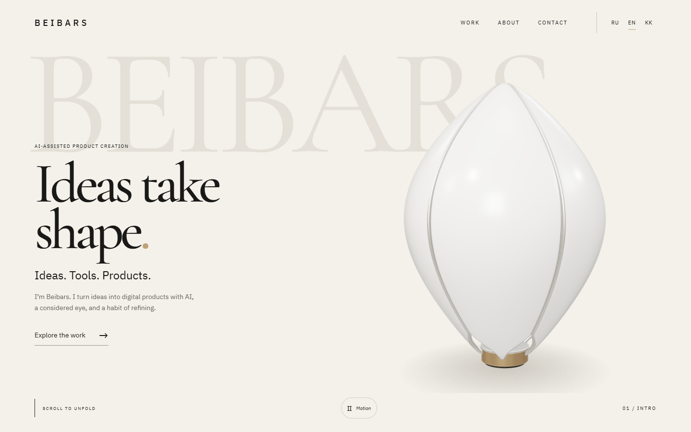
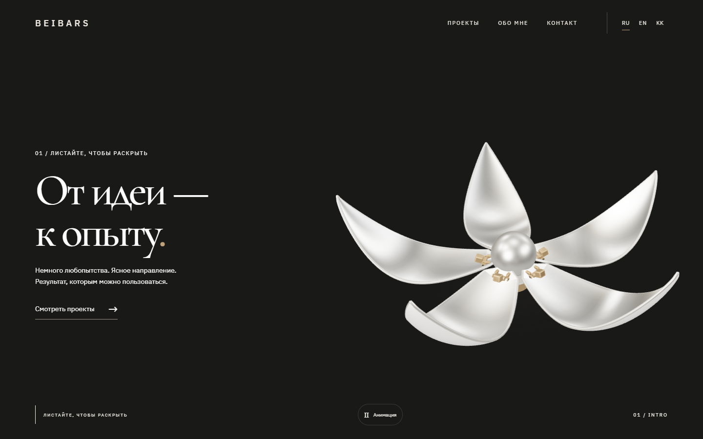
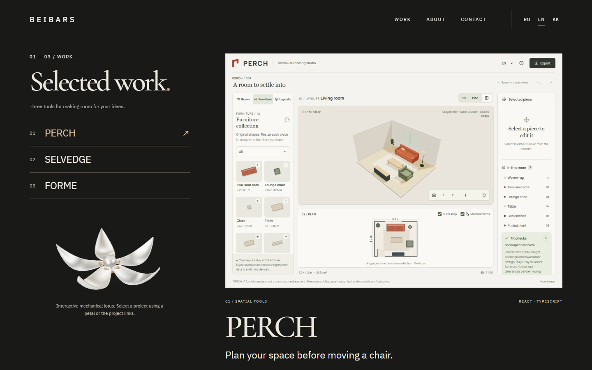
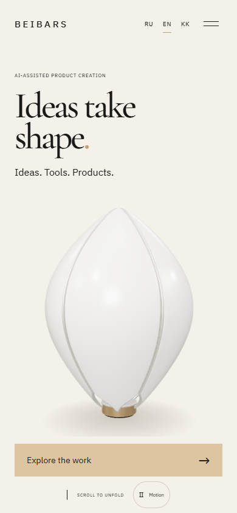
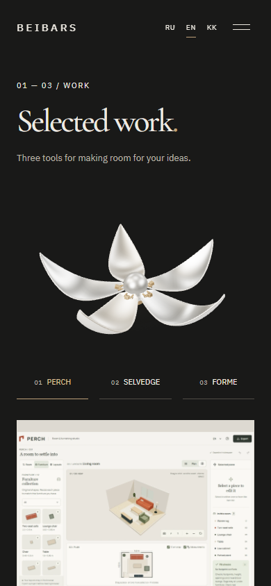

# Lotus release preview

Actual Chrome captures of the integrated site, with the live WebGL model and real project images. These files are review evidence outside the deployed public directory.

| Phone introduction | Phone work index |
| --- | --- |
|  |  |

[Desktop scroll recording](lotus-1440x900.webm) · [Phone viewport recording](lotus-390x844.webm) · [Actual petal selection](petal-picking.png)

[Browser checks and limits](../lotus-browser-tests.md) · [Local performance observations](performance.json) · [Editable model documentation](../lotus-model.md)

The recordings include forward and reverse scrolling and project selection. Phone views are emulated Chrome viewports. Local performance measurements are not physical-device FPS, network benchmarks or a Lighthouse score. All generation and rendering used free local tools; service-credit expenditure was zero.
